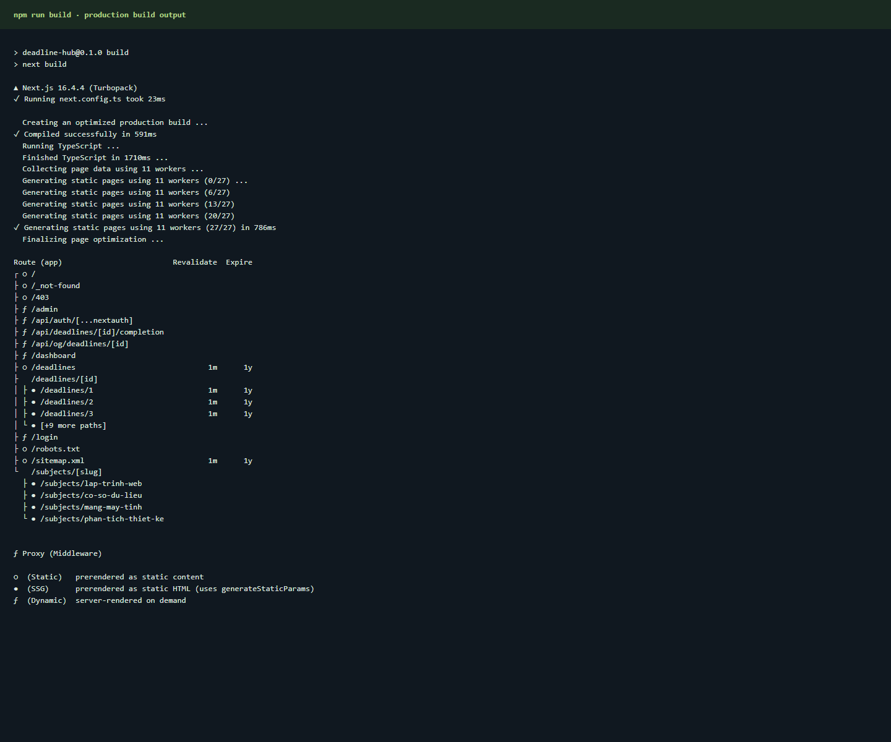
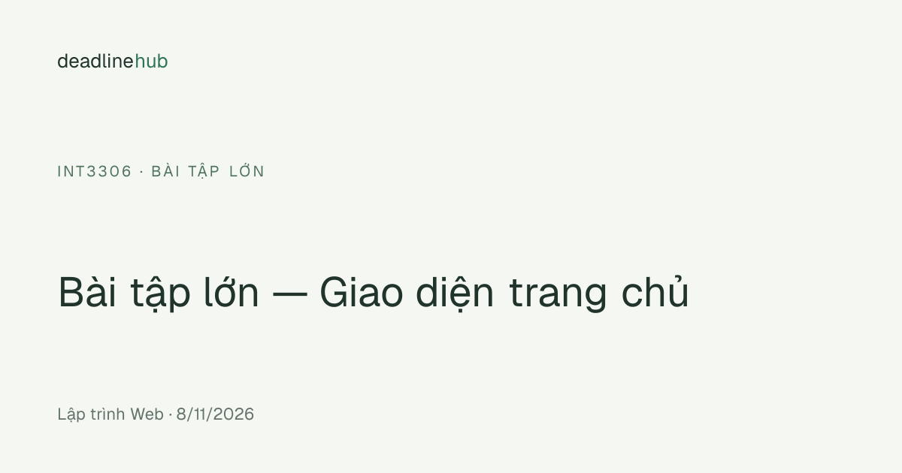
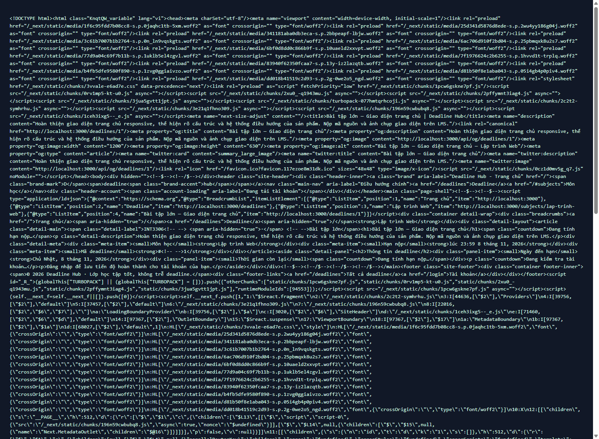

# Class Deadline Hub

Cổng deadline công khai cho lớp, xây dựng bằng Next.js App Router, Auth.js Credentials và dữ liệu JSON phía server.

## Chạy ứng dụng

Yêu cầu Node.js 20.9 trở lên.

```powershell
npm install
$env:AUTH_SECRET = (node -e "console.log(require('node:crypto').randomBytes(32).toString('base64'))")
$env:NEXT_PUBLIC_SITE_URL = "http://localhost:3000"
npm run dev
```

Mở [http://localhost:3000](http://localhost:3000). Để chạy production:

```powershell
$env:AUTH_SECRET = (node -e "console.log(require('node:crypto').randomBytes(32).toString('base64'))")
$env:NEXT_PUBLIC_SITE_URL = "https://class-deadline-hub-iota.vercel.app"
npm run build
npm run start
```

`AUTH_SECRET` phải được giữ bí mật và giống nhau giữa các instance. Tài khoản mẫu theo đề:

| Email | Mật khẩu | Vai trò |
|---|---|---|
| `admin@ptit.edu.vn` | `admin123` | Lớp trưởng / admin |
| `sv@ptit.edu.vn` | `sv123456` | Sinh viên / user |

Danh sách 4 môn và 12 deadline ban đầu nằm trong [`data/deadlines.json`](./data/deadlines.json). Khi chạy local, ứng dụng đọc/ghi file JSON này. Trên Vercel, ứng dụng đọc/ghi cùng cấu trúc JSON trong Vercel Blob riêng tư bằng OIDC (`BLOB_STORE_ID` và token do Vercel tự cấp); file JSON được dùng làm dữ liệu khởi tạo nếu Blob chưa có bản ghi. Cập nhật Blob dùng ETag để từ chối ghi đè khi có thay đổi đồng thời.

## Điểm cộng

### Đăng nhập GitHub (OAuth)

GitHub OAuth đã được tích hợp nhưng **chưa bật trên deployment** vì chưa cấu hình GitHub OAuth App credentials. Để bật, tạo OAuth App tại **Settings → Developer settings → OAuth Apps**:

- Homepage URL: `https://class-deadline-hub-iota.vercel.app`.
- Authorization callback URL: `https://class-deadline-hub-iota.vercel.app/api/auth/callback/github`.

Đặt `AUTH_GITHUB_ID` và `AUTH_GITHUB_SECRET` trong `.env.local` để chạy local hoặc trong **Vercel → Project → Settings → Environment Variables** cho production. Khi cả hai giá trị đã có, trang đăng nhập sẽ hiện nút GitHub; nếu chưa có, Credentials vẫn hoạt động bình thường. Mọi tài khoản GitHub chỉ nhận vai trò `user`, không thể nhận quyền admin qua OAuth.

### Kiểm thử quyền

Chạy `npm test` để kiểm tra toàn bộ 18 tổ hợp role/action của `can()` (bao gồm các quyền dashboard/admin).

### Deploy lên Vercel

Project đã được deploy production tại [https://class-deadline-hub-iota.vercel.app](https://class-deadline-hub-iota.vercel.app). Project được kết nối với Blob store riêng tư; Vercel quản lý thông tin xác thực OIDC. `AUTH_SECRET` và `NEXT_PUBLIC_SITE_URL` đã được cấu hình trong Production. Các lần cập nhật tiếp theo có thể deploy bằng `npx vercel deploy --prod`. Deployment đã kiểm tra trả HTTP 200 cho `/`, `/deadlines/1`, `/login`, `/robots.txt` và `/sitemap.xml`.

Để liên kết GitHub, tạo repository rồi thêm `origin` và push theo hướng dẫn GitHub. Không commit `.env.local`, `.vercel` hoặc token; `.env.example` chỉ chứa tên biến và placeholder, không chứa secret.

## Render strategy

| Route | Chiến lược | Lý do |
|---|---|---|
| `/` | SSG | Trang giới thiệu và dữ liệu lớp có thể xuất HTML sẵn; thao tác admin sẽ revalidate trang. |
| `/subjects/[slug]` | SSG | Có bốn slug xác định, được tạo từ `generateStaticParams`; thêm/xóa deadline cũng revalidate các trang môn. |
| `/deadlines` | ISR, 60 giây | Trang công khai được cache, tự làm mới tối đa sau 60 giây; admin thêm/xóa sẽ revalidate ngay. |
| `/deadlines/[id]` | ISR | Các id ban đầu được prerender, id mới có thể render khi truy cập; revalidate 60 giây làm lớp dự phòng, còn server action gọi `revalidatePath` ngay khi thay đổi dữ liệu. |
| `/dashboard` | SSR | Tổng quan tiến độ cá nhân; cần đọc JWT/session, không đưa nội dung riêng vào static cache. |
| `/dashboard/to-do`, `/dashboard/completed` | SSR | Các trang riêng cho deadline chưa hoàn thành và đã hoàn thành của tài khoản hiện tại; dùng chung layout dashboard có sidebar và menu tô sáng route hiện tại. |
| `/admin` | SSR | Cần xác thực và kiểm tra quyền admin trên server ở mỗi request. |

Build report dùng ký hiệu `○` cho static, `●` cho SSG và `ƒ` cho render động; route prerender có ISR vẫn được build từ HTML tĩnh ban đầu rồi tái tạo theo chu kỳ. `cacheComponents` được tắt để dùng cấu hình ISR `revalidate` truyền thống của đề.

### Ảnh kết quả `npm run build`



## Lighthouse production

Kết quả Lighthouse 13.6.0 với Chrome, preset mobile mặc định, trên bản production build (`npm run build` rồi `npm run start`) tại `http://localhost:3000`. Các điểm dưới đây là lượt đo ứng dụng production-mode chạy cục bộ, **không phải** báo cáo Lighthouse từ domain Vercel; điểm có thể thay đổi theo thiết bị và môi trường:

| Trang | Performance | Accessibility | Best Practices | SEO |
|---|---:|---:|---:|---:|
| `/` | **93** | 95 | 100 | 100 |
| `/deadlines/1` | **100** | 95 | 100 | 100 |

Ảnh trang chủ trong lượt đo: [homepage.png](./evidence/homepage.png).

## HTML, metadata và chia sẻ

Trang chi tiết sinh title/description, canonical, Open Graph và Twitter metadata theo deadline. Ảnh OG riêng được render bằng `ImageResponse`. Sitemap chứa trang chủ, bốn môn và mọi deadline; robots chặn `/dashboard` và `/admin`. `/login`, `/dashboard`, `/admin` có metadata `noindex`; `/login` không bị robots chặn để crawler có thể đọc chỉ thị `noindex`.

Endpoint ảnh chia sẻ có URL ổn định `GET /api/og/deadlines/[id]`; đã kiểm tra `/api/og/deadlines/1` trả `image/png` 1200 × 630.



### Ảnh HTML nguồn của `/deadlines/1`

Mở [trang deadline 1 trên production](https://class-deadline-hub-iota.vercel.app/deadlines/1), sau đó nhấn `Ctrl+U` (hoặc chọn **View page source**) để xem HTML server-rendered. Ảnh minh chứng bên dưới là HTML nguồn của route này; title, description, canonical, Open Graph, nội dung deadline và BreadcrumbList JSON-LD được render phía server.



## Quyền truy cập

Ma trận quyền tập trung tại [`src/lib/authorization.ts`](./src/lib/authorization.ts), thông qua `can(role, action)`. Middleware giữ lại `callbackUrl` khi khách truy cập `/dashboard` hoặc `/admin`; user truy cập `/admin` được chuyển tới `/403`. Trang admin và từng Server Action vẫn kiểm tra quyền độc lập, đồng thời validate dữ liệu đầu vào.

## Trả lời câu hỏi bắt buộc

### 1. Vì sao `/deadlines/[id]` dùng ISR?

Em chọn ISR vì deadline cần hiển thị công khai và có thể chia sẻ, nên trang được tạo sẵn để tải nhanh và Google đọc được nội dung. Khi admin thêm hoặc xóa deadline, hệ thống gọi `revalidatePath` để cập nhật trang đó ngay; `revalidate = 60` là thời gian làm mới dự phòng. Như vậy, không phải build lại toàn bộ website mỗi lần thay đổi deadline.

### 2. Nếu chỉ dùng Middleware để bảo vệ `/admin` thì có rủi ro gì?

Nếu chỉ kiểm tra Middleware, người dùng vẫn có thể gửi request trực tiếp đến Server Action để thử thêm hoặc xóa deadline mà không mở trang `/admin`. Vì vậy, trang admin và từng Server Action phải tự kiểm tra session, role admin và dữ liệu đầu vào ở phía server. Trong project này, các thao tác thêm/xóa đều kiểm tra quyền trước khi cập nhật JSON.

## Kiểm tra đã chạy

- `npm run build`: build thành công; các route SSG, ISR và SSR xuất hiện đúng trong route table.
- `npm run lint`: không có lỗi.
- `npm test`: cả 18 kiểm thử cho `can()` đều đạt.
- Bản deploy: [https://class-deadline-hub-iota.vercel.app](https://class-deadline-hub-iota.vercel.app). Đã kiểm tra trang chủ, `/deadlines/1`, `/login`, `robots.txt` và `sitemap.xml`; các trang trả mã HTTP 200. Deadline 1 có nội dung và BreadcrumbList trong HTML server-rendered.
